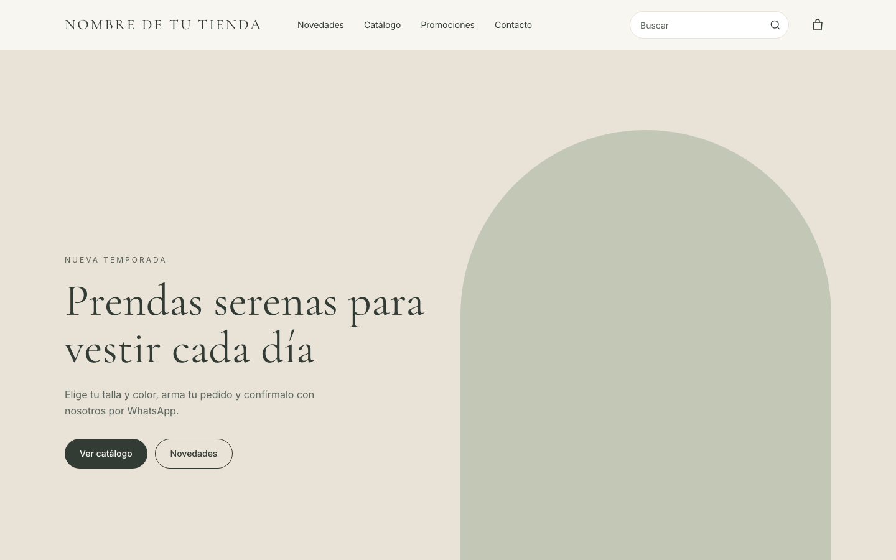
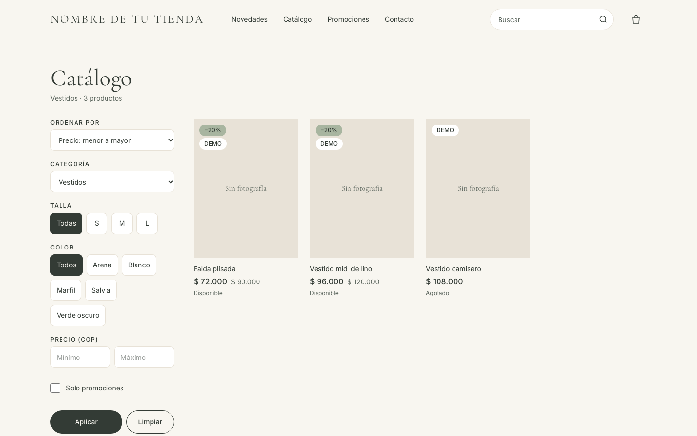
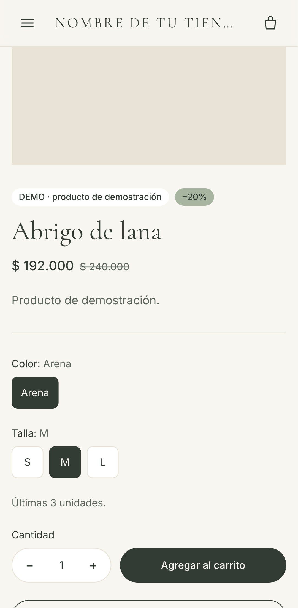
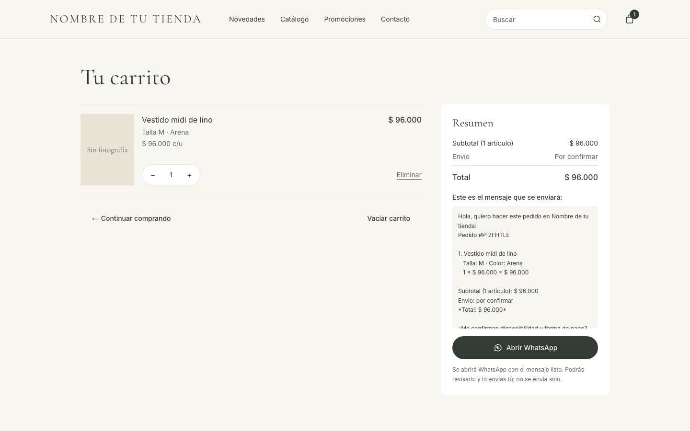
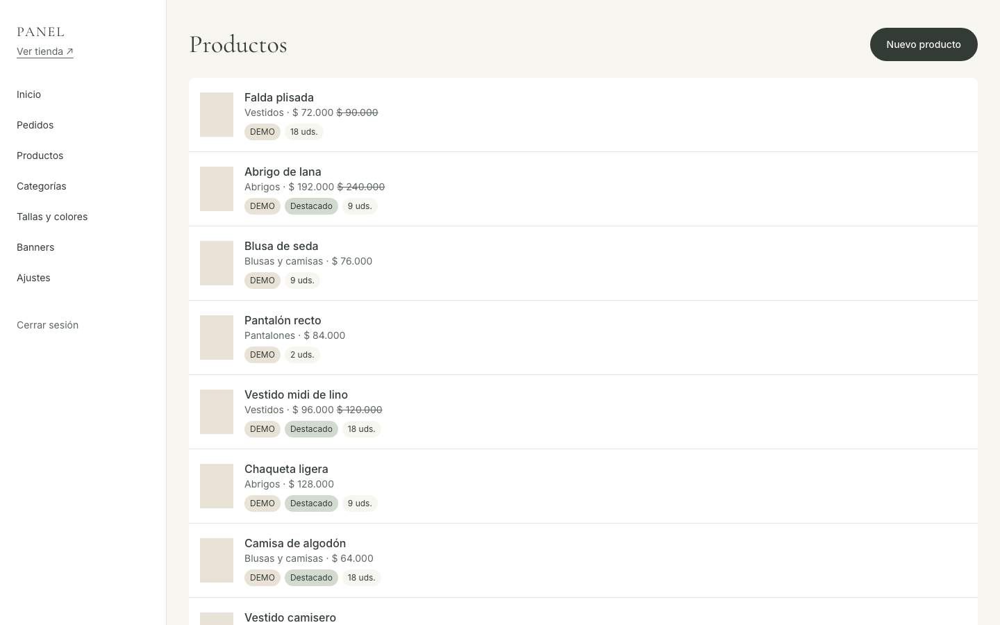
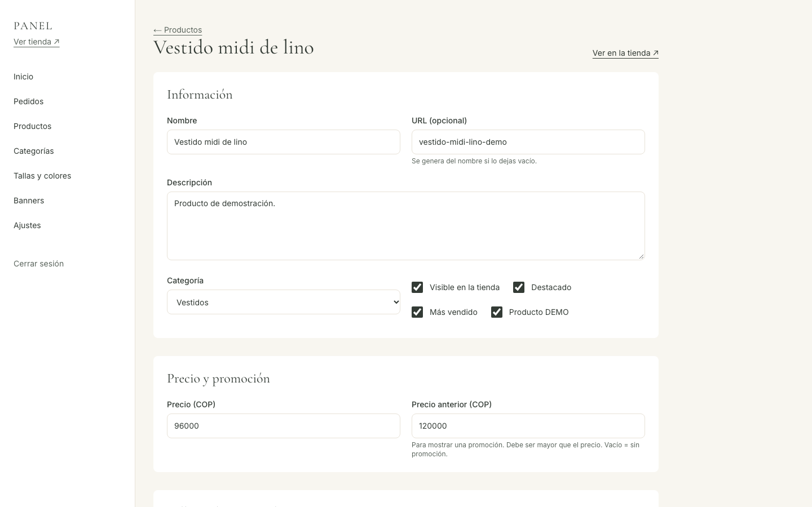

# Tienda boutique con pedidos por WhatsApp

Tienda online de ropa con catálogo, tallas y colores, carrito y un checkout que **abre WhatsApp con el pedido ya escrito**. Incluye un panel de administración para gestionar productos, fotos, precios, promociones y pedidos sin tocar código.

> Los productos marcados **DEMO** son contenido de demostración, no mercancía real.



## Qué problema resuelve

Muchas tiendas pequeñas venden por WhatsApp y no necesitan (o no pueden pagar) una pasarela de pago. Esta tienda permite que el cliente explore el catálogo, elija talla y color y arme su pedido. Al finalizar, se abre WhatsApp con un resumen ordenado (productos, tallas, colores, cantidades, precios y total) y un código de pedido. El cliente revisa el mensaje y lo envía; la tienda confirma pago y envío en el chat.

## Funcionalidades

| Tienda | Panel de administración |
|---|---|
| Catálogo con búsqueda (sin importar tildes), filtros por categoría, talla, color, precio y promoción | Login seguro y cambio de contraseña |
| Ficha de producto con galería, variantes y stock por talla y color | Crear, editar, ocultar y eliminar productos; fotos; stock por variante |
| Carrito que se conserva al recargar | Categorías, tallas, colores y banner de portada |
| Checkout por WhatsApp con código de pedido | Pedidos con búsqueda por código y cambio de estado |
| Página de contacto con horarios y preguntas frecuentes | Ajustes de contacto, redes, horarios y preguntas frecuentes |

## Capturas

| Catálogo con filtros | Ficha de producto en móvil |
|---|---|
|  |  |

| Carrito y mensaje de WhatsApp | Panel: productos |
|---|---|
|  |  |

| Panel: editar producto |
|---|
|  |

## Decisiones técnicas

- **El servidor no confía en el carrito del navegador.** El carrito vive en `localStorage`, que el usuario puede modificar. Al finalizar, el servidor vuelve a leer precio, variante y stock de la base de datos, corrige el carrito y avisa al cliente si algo cambió (`services/checkout.ts`).
- **Pedido registrado antes de abrir WhatsApp.** Cada pedido se guarda con un código (`P-XXXXXX`) que viaja en el mensaje, así la tienda lo encuentra en el panel.
- **Autenticación sin librerías externas.** Contraseñas con `scrypt` y sesión en una cookie firmada con HMAC. Cambiar la contraseña invalida las demás sesiones (`services/auth/`).
- **Fotos validadas por su contenido,** no por la extensión: un SVG renombrado a `.jpg` se rechaza (`services/uploads.ts`).
- **SQLite + Docker con volumen** en lugar de una plataforma *serverless*: una boutique no necesita varios servidores, y así la base y las fotos viven en un disco persistente, con un costo de unos pocos dólares al mes.
- **Caché del catálogo con invalidación:** las páginas de la tienda se sirven rápido desde caché y se actualizan al instante cuando se guarda algo en el panel.

## Calidad

- **40 pruebas unitarias** (Vitest): filtros, carrito, checkout, contraseñas, sesión, subidas y formularios.
- **17 pruebas de punta a punta** (Playwright) en escritorio y móvil, sobre una base de datos aislada: compra completa, validaciones, panel, 404, cabeceras de seguridad y ausencia de scroll horizontal en móvil.
- Contraste de colores revisado según WCAG AA; diseño pensado primero para móvil.

## Cómo se construyó

Este proyecto se desarrolló **con un asistente de IA (Claude, de Anthropic)**, que escribió el código. Los commits lo indican con la línea `Co-Authored-By`.

Mi papel:

- Definí los requisitos del negocio: catálogo, variantes, checkout por WhatsApp sin pasarela de pago, panel administrativo, paleta de colores y prioridades de seguridad.
- Organicé el trabajo en 8 fases y revisé y aprobé cada una antes de pasar a la siguiente.
- Tomé las decisiones de producto: moneda (COP), contenido de demostración identificado como tal y plataforma de despliegue.
- Verifiqué el resultado en el navegador, en escritorio y móvil, en cada fase.

La guía [docs/como-funciona.md](docs/como-funciona.md) explica cada parte del código en lenguaje simple.

## Stack

Next.js 16 (App Router, Cache Components) · React 19 · TypeScript · Tailwind CSS 4 · Prisma 7 (SQLite / PostgreSQL) · Zod · Vitest · Playwright · Docker.

## Instalación local

### Requisitos

- Node.js 20.9 o superior y npm

### Puesta en marcha

```bash
npm install
cp .env.example .env.local   # completa los valores
npm run db:migrate           # crea la base de datos SQLite
npm run db:seed              # tallas, colores, categorías, admin y productos DEMO
npm run dev                  # http://localhost:3000
```

## Scripts

| Comando | Qué hace |
|---|---|
| `npm run dev` | Servidor de desarrollo |
| `npm run build` | Build de producción |
| `npm start` | Sirve el build |
| `npm run lint` | ESLint |
| `npm test` | Pruebas unitarias (Vitest) |
| `npm run test:e2e` | Pruebas de punta a punta en escritorio y móvil (Playwright). Usan su propia base de datos y build en el puerto 3100. La primera vez: `npx playwright install chromium` |
| `npm run db:migrate` | Aplica/crea migraciones en desarrollo |
| `npm run db:deploy` | Aplica migraciones en producción |
| `npm run db:seed` | Carga datos base solo en tablas vacías (con `SEED_DEMO=0` omite los productos DEMO) |
| `npm run db:backup` | Copia de seguridad de la base SQLite (conserva las 14 últimas) |
| `npm run start:prod` | Arranque de producción: migraciones, datos base, build y servidor |

## Variables de entorno

Ver [`.env.example`](.env.example). Ninguna credencial va en el código. `WHATSAPP_NUMBER` debe llevar solo dígitos con código de país; si está vacío, los botones de WhatsApp no se muestran.

## Estructura

```
app/(tienda)/   páginas públicas: inicio, catálogo, producto, carrito, contacto
app/admin/      panel administrativo (login y secciones)
app/uploads/    entrega de las fotos subidas
proxy.ts        primera barrera de acceso a /admin
components/     ui/ (piezas genéricas), tienda/ y admin/ (formularios)
services/       catálogo, checkout, pedidos, auth, subidas, validación de formularios
models/         tipos y reglas de dominio (promociones, stock)
database/       esquema Prisma, migraciones, cliente, seed y datos DEMO
styles/         tokens de la paleta y estilos globales
tests/          unit/ (Vitest) y e2e/ (Playwright)
public/         archivos estáticos y uploads/
```


## Panel administrativo (`/admin`)

Acceso con el correo y la contraseña de `ADMIN_EMAIL` / `ADMIN_INITIAL_PASSWORD` (los crea `npm run db:seed`). **Cambia la contraseña en Ajustes tras el primer acceso.**

| Sección | Qué permite |
|---|---|
| Pedidos | Buscar por código (`P-XXXXXX`), filtrar por estado y cambiarlo (pendiente, confirmado, entregado, cancelado) |
| Productos | Crear, editar, ocultar y eliminar; precio y precio anterior (promoción); destacado / más vendido; stock por talla y color; fotos |
| Categorías, Tallas y colores | Altas, cambios, orden y borrado (no se borra lo que está en uso) |
| Banners | Texto, enlace, imagen y orden del banner de portada |
| Ajustes | Sobre la tienda, correo, dirección, redes, horarios, preguntas frecuentes y cambio de contraseña |

Los cambios se ven en la tienda al instante (se invalida la caché del catálogo).

**Seguridad del panel**
- Contraseñas con scrypt; sesión en cookie `httpOnly` firmada con HMAC (`SESSION_SECRET`), 8 horas.
- Cambiar la contraseña cierra las sesiones abiertas en otros dispositivos.
- 5 intentos de acceso fallidos por IP cada 15 minutos.
- `proxy.ts` bloquea `/admin` sin cookie y cada página y acción vuelve a verificar la sesión.
- Fotos: solo JPG, PNG o WebP verificados por su contenido, máximo `MAX_UPLOAD_MB` MB, nombre aleatorio. Se guardan en `storage/uploads` (o `UPLOAD_DIR`) y se sirven en `/uploads/...`.

## Seguridad de la tienda

- Cabeceras: Content-Security-Policy, X-Frame-Options, nosniff, Referrer-Policy, Permissions-Policy y HSTS cuando `STORE_URL` es https.
- Checkout: precios y stock se recalculan en el servidor; máximo 10 pedidos por IP y hora.
- Validación con zod en el servidor para todo formulario; React escapa todo el contenido mostrado.
- `robots.txt` excluye `/admin` y `/carrito`; los productos DEMO llevan `noindex` y no van al `sitemap.xml`.

## Cómo funciona el pedido por WhatsApp

1. El carrito se guarda en el navegador (`localStorage`).
2. Al pulsar **Finalizar pedido por WhatsApp**, el servidor revisa cada producto contra el catálogo: precio actual, variante existente y stock. Si algo cambió, corrige el carrito y avisa al cliente.
3. Se registra el pedido en la base de datos con un código (`P-XXXXXX`, estado *pendiente*) que también va en el mensaje, para ubicarlo luego en el panel.
4. Se muestra el mensaje exacto que se enviará y el botón **Abrir WhatsApp** (`https://wa.me/NUMERO?text=...`). El cliente revisa y envía; nada se envía solo.

## Despliegue

La tienda se publica con **Docker**. La imagen guarda todo lo que cambia (base de datos SQLite, fotos y copias de seguridad) en `/data`, que debe ser un **volumen persistente**.

Al arrancar, `scripts/start.sh` aplica las migraciones, crea los datos base y el administrador si la base está vacía, **compila con la base real** (para que el catálogo prerenderizado esté al día) y levanta el servidor. El primer arranque tarda 1–2 minutos.

### Opción recomendada: Railway

1. Crea una cuenta en [railway.com](https://railway.com) y conecta tu GitHub.
2. **New Project → Deploy from GitHub repo →** `tienda-boutique`. Railway detecta el `Dockerfile` (y `railway.json`).
3. En el servicio: **Settings → Volumes → Add volume**, punto de montaje **`/data`**.
4. **Settings → Networking → Generate Domain** (o conecta tu dominio propio con un registro CNAME).
5. **Variables** (todas obligatorias salvo indicación):

   | Variable | Valor |
   |---|---|
   | `STORE_URL` | La URL pública con https, p. ej. `https://mitienda.up.railway.app` |
   | `STORE_NAME` | Nombre de la tienda |
   | `STORE_LOCALE` / `STORE_CURRENCY` | `es-CO` / `COP` |
   | `WHATSAPP_NUMBER` | Solo dígitos con código de país |
   | `SESSION_SECRET` | Resultado de `openssl rand -base64 48` (nuevo, no reutilices el de desarrollo) |
   | `ADMIN_EMAIL` | Tu correo de administrador |
   | `ADMIN_INITIAL_PASSWORD` | Contraseña inicial (mín. 10 caracteres). Cámbiala en el panel tras entrar |
   | `MAX_UPLOAD_MB` | Opcional, `5` por defecto |

   `DATABASE_URL`, `UPLOAD_DIR` y `BACKUP_DIR` ya vienen definidas en la imagen apuntando a `/data`.
6. Despliega. Cada `git push` a `main` vuelve a desplegar; los datos del volumen se conservan.

**¿Quieres empezar con los productos DEMO?** En producción no se cargan. Si los quieres para ver la tienda llena, ejecuta una vez en la consola del servicio: `npx tsx database/seed.ts` (solo actúa si no hay productos).

**Copias de seguridad:** activa los *backups* del volumen en Railway y/o ejecuta `npm run db:backup` desde la consola del servicio (guarda en `/data/backups`). Para guardar una copia fuera del servidor, descarga ese archivo.

### Alternativa: un VPS con Docker

```bash
docker build -t tienda-boutique .
docker run -d --name tienda --restart unless-stopped -p 3000:3000 -v tienda-data:/data \
  -e STORE_URL=https://tudominio.com -e STORE_NAME="..." -e WHATSAPP_NUMBER=57... \
  -e SESSION_SECRET="$(openssl rand -base64 48)" -e ADMIN_EMAIL=... -e ADMIN_INITIAL_PASSWORD=... \
  tienda-boutique
```

Pon delante un proxy con HTTPS (por ejemplo Caddy: `tudominio.com { reverse_proxy localhost:3000 }`). Programa `docker exec tienda npm run db:backup` con cron y copia `/data/backups` fuera del servidor.

### Limitaciones conocidas

- **Una sola instancia.** SQLite, las fotos en disco y el límite de intentos en memoria asumen un único servidor (lo normal para una boutique). Para escalar a varias instancias: PostgreSQL (`provider = "postgresql"` en `database/schema.prisma` + `@prisma/adapter-pg` en `database/client.ts`), fotos en almacenamiento S3 compatible y límites en la base de datos.
- **Vercel u otros servicios *serverless* no sirven tal cual**: no tienen disco persistente para la base ni para las fotos.

### Lista de verificación antes de anunciar la tienda

- [ ] Entrar a `/admin`, cambiar la contraseña inicial.
- [ ] Revisar Ajustes: sobre la tienda, redes, horarios y preguntas frecuentes.
- [ ] Crear categorías y productos reales con fotos; eliminar o desmarcar los DEMO si los cargaste.
- [ ] Editar el banner de portada.
- [ ] Hacer un pedido de prueba desde el celular y comprobar que llega bien a WhatsApp.
- [ ] Comprobar `https://tu-dominio/robots.txt` y `/sitemap.xml`; dar de alta el sitio en Google Search Console.

## Licencia

[MIT](LICENSE).
